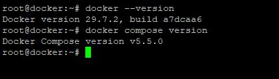
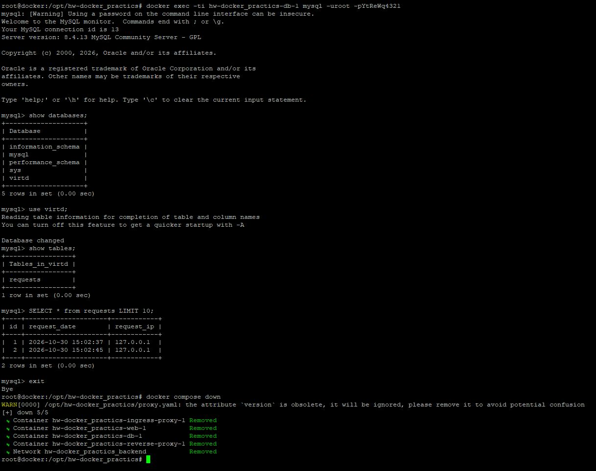
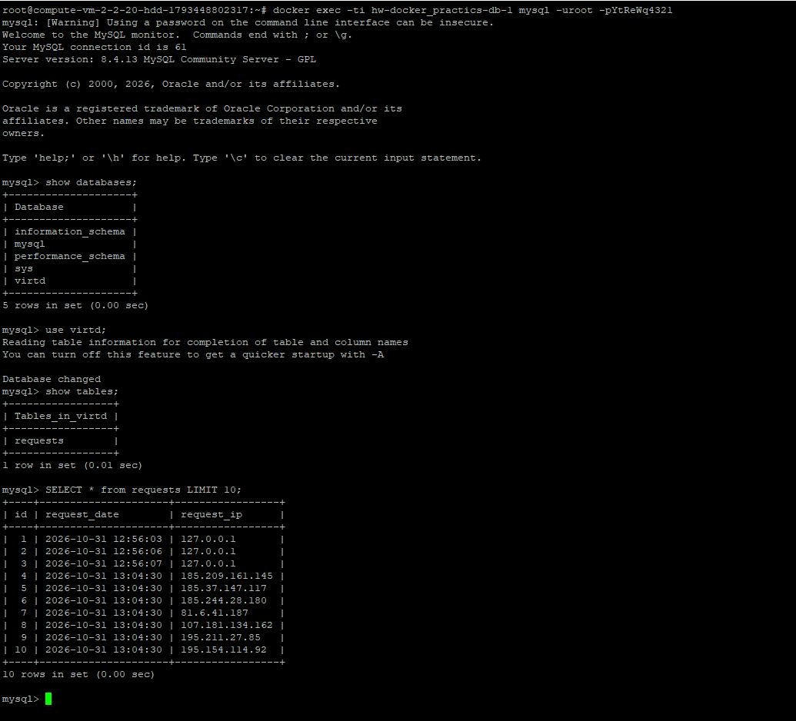
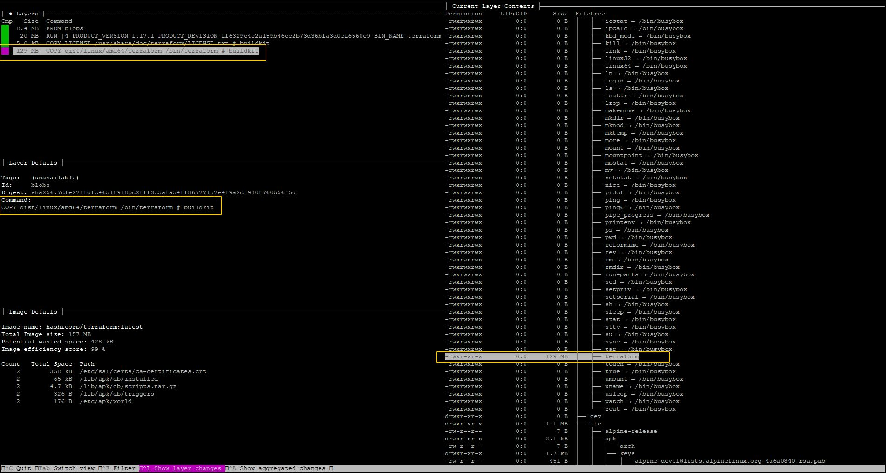
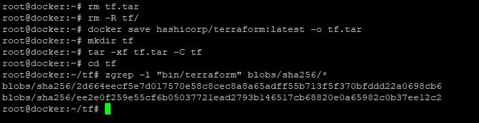
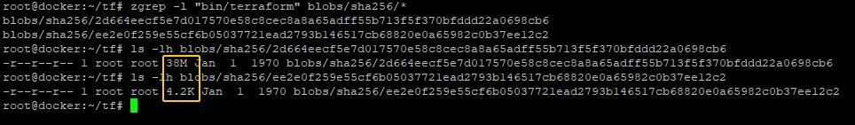
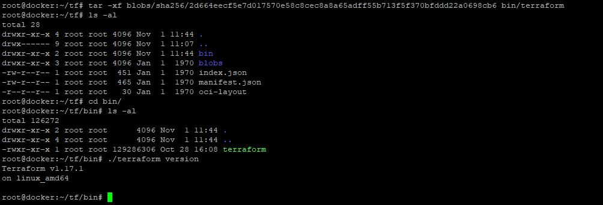

# Домашнее задание к занятию 5. «Практическое применение Docker» `Гуреев Юрий`

### Инструкция к выполнению

1. Для выполнения заданий обязательно ознакомьтесь с [инструкцией](https://github.com/netology-code/devops-materials/blob/master/cloudwork.MD) по экономии облачных ресурсов. Это нужно, чтобы не расходовать средства, полученные в результате использования промокода.
3. **Своё решение к задачам оформите в вашем GitHub репозитории.**
4. В личном кабинете отправьте на проверку ссылку на .md-файл в вашем репозитории.
5. Сопроводите ответ необходимыми скриншотами.

---
## Примечание: Ознакомьтесь со схемой виртуального стенда [по ссылке](https://github.com/netology-code/shvirtd-example-python/blob/main/schema.pdf)

---

## Задача 0
1. Убедитесь что у вас НЕ(!) установлен ```docker-compose```, для этого получите следующую ошибку от команды ```docker-compose --version```
```
Command 'docker-compose' not found, but can be installed with:

sudo snap install docker          # version 24.0.5, or
sudo apt  install docker-compose  # version 1.25.0-1

See 'snap info docker' for additional versions.
```
В случае наличия установленного в системе ```docker-compose``` - удалите его.  
2. Убедитесь что у вас УСТАНОВЛЕН ```docker compose```(без тире) версии не менее v2.24.X, для это выполните команду ```docker compose version```  
###  **Своё решение к задачам оформите в вашем GitHub репозитории!!!!!!!!!!!!!!!!!!!!!!!!!!!!!!!!**

## Решение



---

## Задача 1
1. Сделайте в своем GitHub пространстве fork [репозитория](https://github.com/netology-code/shvirtd-example-python).

2. Создайте файл ```Dockerfile.python``` на основе существующего `Dockerfile`:
   - Используйте базовый образ ```python:3.12-slim```
   - Обязательно используйте конструкцию ```COPY . .``` в Dockerfile
   - Создайте `.dockerignore` файл для исключения ненужных файлов
   - Используйте ```CMD ["uvicorn", "main:app", "--host", "0.0.0.0", "--port", "5000"]``` для запуска
   - Протестируйте корректность сборки
2.1 Используйте multistage сборку вместо single stage.
3. (Необязательная часть, *) Изучите инструкцию в проекте и запустите web-приложение без использования docker, с помощью venv. (Mysql БД можно запустить в docker run).
4. (Необязательная часть, *) Изучите код приложения и добавьте управление названием таблицы через ENV переменную.
---
### ВНИМАНИЕ!
!!! В процессе последующего выполнения ДЗ НЕ изменяйте содержимое файлов в fork-репозитории! Ваша задача ДОБАВИТЬ 5 файлов: ```Dockerfile.python```, ```compose.yaml```, ```.gitignore```, ```.dockerignore```,```bash-скрипт```. Если вам понадобилось внести иные изменения в проект - вы что-то делаете неверно!

## Решение
[.gitignore файл](https://github.com/mhfhfmn/hw-docker_practics/blob/main/.gitignore)

[.dockerignore файл](https://github.com/mhfhfmn/hw-docker_practics/blob/main/.dockerignore)

[Dockerfile.python](https://github.com/mhfhfmn/hw-docker_practics/blob/main/Dockerfile.python)

Для управления названием таблицы была добавлена инструкция считывания названия из файла .env(переменная `DB_TABLE`) по аналогии с остальными переменными в `db_table` в main.py:
`db_table = os.environ.get('DB_TABLE', 'requests')`
Далее в запросах используются f-строки для подстановки значения переменной `db_table`, например:
`query = f"INSERT INTO {db_table} (request_date, request_ip) VALUES (%s, %s)"`

---


## Задача 3
1. Изучите файл "proxy.yaml"
2. Создайте в репозитории с проектом файл ```compose.yaml```. С помощью директивы "include" подключите к нему файл "proxy.yaml".
3. Опишите в файле ```compose.yaml``` следующие сервисы: 

- ```web```. Образ приложения должен ИЛИ собираться при запуске compose из файла ```Dockerfile.python``` ИЛИ скачиваться из yandex cloud container registry(из задание №2 со *). Контейнер должен работать в bridge-сети с названием ```backend``` и иметь фиксированный ipv4-адрес ```172.20.0.5```. Сервис должен всегда перезапускаться в случае ошибок.
Передайте необходимые ENV-переменные для подключения к Mysql базе данных по сетевому имени сервиса ```web``` 

- ```db```. image=mysql:8. Контейнер должен работать в bridge-сети с названием ```backend``` и иметь фиксированный ipv4-адрес ```172.20.0.10```. Явно перезапуск сервиса в случае ошибок. Передайте необходимые ENV-переменные для создания: пароля root пользователя, создания базы данных, пользователя и пароля для web-приложения.Обязательно используйте уже существующий .env file для назначения секретных ENV-переменных!

4. Запустите проект локально с помощью docker compose , добейтесь его стабильной работы: команда ```curl -L http://127.0.0.1:8090``` должна возвращать в качестве ответа время и локальный IP-адрес. Если сервисы не стартуют воспользуйтесь командами: ```docker ps -a ``` и ```docker logs <container_name>``` . Если вместо IP-адреса вы получаете информационную ошибку --убедитесь, что вы шлете запрос на порт ```8090```, а не 5000.

5. Подключитесь к БД mysql с помощью команды ```docker exec -ti <имя_контейнера> mysql -uroot -p<пароль root-пользователя>```(обратите внимание что между ключем -u и логином root нет пробела. это важно!!! тоже самое с паролем) . Введите последовательно команды (не забываем в конце символ ; ): ```show databases; use <имя вашей базы данных(по-умолчанию virtd, как это указано в .env)>; show tables; SELECT * from requests LIMIT 10;```. Примечание: таблица в БД создается после первого поступившего запроса к приложению.

6. Остановите проект. В качестве ответа приложите скриншот sql-запроса.

## Решение
Так как оба сервиса ожидают разные разные переменные(например для запуска mysql необходима переменная `MYSQL_ROOT_PASSWORD`, в то время как в main.py ожидается переменная `DB_PASSWORD`), в сервисе web мы переопределим переменные согласно файлу main.py, а сервису db мы скормим .env файл как есть. Укажем ip адреса в виртуальной сети backend и сборку образа для контейнера из файла Dockerfile.python из задания 1.

[compose.yaml](https://github.com/mhfhfmn/hw-docker_practics/blob/main/compose.yaml)



Погасим проект командой `docker compose down`

---


## Задача 4
1. Запустите в Yandex Cloud ВМ (вам хватит 2 Гб Ram).
2. Подключитесь к Вм по ssh и установите docker.
3. Напишите bash-скрипт, который скачает ваш fork-репозиторий в каталог /opt и запустит проект целиком.
4. Зайдите на сайт проверки http подключений, например(или аналогичный): ```https://check-host.net/check-http``` и запустите проверку вашего сервиса ```http://<внешний_IP-адрес_вашей_ВМ>:8090```. Таким образом трафик будет направлен в ingress-proxy. Трафик должен пройти через цепочки: Пользователь → Internet → Nginx → HAProxy → FastAPI(запись в БД) → HAProxy → Nginx → Internet → Пользователь
5. (Необязательная часть) Дополнительно настройте remote ssh context к вашему серверу. Отобразите список контекстов и результат удаленного выполнения ```docker ps -a```
6. Повторите SQL-запрос на сервере и приложите скриншот и ссылку на fork.

## Решение

Ранее я удалил .env файл и deploy.sh и добавил из в .gitignore, так как в .env файлах содержаться секреты, которые недопустимо выставлять в открытый доступ, и вынес создания   .env в deploy.sh, но в нем так же содержатся секреты, поэтому было принято решение вынести скрипт deploy.sh за пределы самого форка на другой сервис. Сейчас с наличием .env фалйа в репозитории необходимости в этом нету, блок создания закоментирован.

По сути весь деплой сводится к 2 командам:
Установка docker compose:
`curl -fsSL https://get.docker.com | sh`
Скачивание и запуск скрипта из репозитория:
`wget -qO deploy.sh https://raw.githubusercontent.com/mhfhfmn/hw-docker_practics/blob/main/deploy.sh && chmod +x deploy.sh && sudo ./deploy.sh`

[deploy скрипт](https://github.com/mhfhfmn/hw-docker_practics/blob/main/deploy.sh)



---

## Задача 6
Скачайте docker образ ```hashicorp/terraform:latest``` и скопируйте бинарный файл ```/bin/terraform``` на свою локальную машину, используя dive и docker save.
Предоставьте скриншоты действий .

## Решение

С помощью утилиты dive мы можем проанализировать готовый образ, для этого нам сначала необходимо скачать его с репозитория образов, установим утилиту, скачаем образ и выполник команду:

```
wget https://github.com/wagoodman/dive/releases/download/v0.12.0/dive_0.12.0_linux_amd64.deb
sudo apt install ./dive_0.12.0_linux_amd64.deb
docker pull hashicorp/terraform:latest
dive hashicorp/terraform:latest
```


На скриншоте утилиты мы можем видеть 4 слоя образа, на самом последнем слое добавляется искомый файл /bin/terraform, эта информация нам пригодится для поиска исполняемого файла.

Далее необходимо выгрузить образ как архив, затем распоковать его и произвести поиск утилитой zgrep выполним команду:
```
docker save hashicorp/terraform:latest -o tf.tar
mkdir tf
tar -xf tf.tar -C tf
cd tf
zgrep -l "bin/terraform" blobs/sha256/*
```


на скриншоте видно 2 совпадения:

```
blobs/sha256/2d664eecf5e7d017570e58c8cec8a8a65adff55b713f5f370bfddd22a0698cb6
blobs/sha256/ee2e0f259e55cf6b05037721ead2793b146517cb68820e0a65982c0b37ee12c2
```

Посмотрим их размеры, больший из них содержит необходимый нам файл:
```
ls -lh blobs/sha256/2d664eecf5e7d017570e58c8cec8a8a65adff55b713f5f370bfddd22a0698cb6
ls -lh blobs/sha256/ee2e0f259e55cf6b05037721ead2793b146517cb68820e0a65982c0b37ee12c2
```



Нас интересует blob c хэшем 2d664eecf5e7d017570e58c8cec8a8a65adff55b713f5f370bfddd22a0698cb6
Извлечем из него необходимый файл командой:

`tar -xf blobs/sha256/2d664eecf5e7d017570e58c8cec8a8a65adff55b713f5f370bfddd22a0698cb6 bin/terraform`

После выполнения команды в текущем каталоге появится папка bin с искомым файлом.



Далее необходимо перенести его в необходимое место, например в каталог /bin на локальной машине